# BAB I PENDAHULUAN

## 1.1 Latar Belakang

Termodinamika membahas perubahan energi dan batas proses fisis. Dalam pembelajaran, mahasiswa perlu membedakan energi yang tersimpan sebagai sifat keadaan dengan energi yang melintasi batas sistem sebagai kalor atau usaha. Mahasiswa juga harus memahami bahwa penggunaan rumus bergantung pada jenis sistem, proses, satuan, serta kesepakatan tanda. Misalnya, persamaan usaha tekanan konstan tidak dapat diterapkan begitu saja pada setiap perubahan volume.

Media web memungkinkan materi konseptual, contoh perhitungan, dan tampilan visual diakses dalam satu lingkungan. Pengguna dapat membaca penjelasan, memprediksi hasil, mengganti parameter, kemudian membandingkan hasil yang muncul dengan persamaan. Umpan balik kuis dan pembahasan jawaban memberikan kesempatan menelusuri alasan suatu pilihan benar.

THERMPYX dikembangkan sebagai proyek mata kuliah Termodinamika pada Program Studi Bilingual Pendidikan Fisika, Universitas Negeri Medan. Tujuannya menyediakan sarana pendamping belajar yang mudah diakses melalui peramban serta memperlihatkan hubungan antara teori, perhitungan, dan representasi proses. Tampilan futuristik, pilihan tema, dan interaksi profil merupakan bagian dari pengalaman penggunaan; pencapaian akademik tetap berpusat pada ketepatan konsep dan penalaran.

## 1.2 Rumusan Masalah

1. Bagaimana menyajikan materi termodinamika secara terstruktur melalui web?
2. Bagaimana menerapkan persamaan dasar dalam kalkulator dan simulasi dengan asumsi yang jelas?
3. Bagaimana menyediakan latihan dengan umpan balik dan pembahasan jawaban?
4. Bagaimana memeriksa fungsi aplikasi serta menjelaskan keterbatasan hasil pemeriksaannya?

## 1.3 Tujuan dan Manfaat

Proyek bertujuan menghasilkan media yang menghubungkan tujuh topik, membantu pengguna melakukan perhitungan dasar, menyediakan aktivitas visual dan latihan, serta mendokumentasikan pengujian yang dapat diulang. Bagi mahasiswa, aplikasi menjadi sarana eksplorasi mandiri. Bagi pengajar, bank soal dan kuis langsung menyediakan pilihan aktivitas kelas. Bagi pengembang, proyek menjadi latihan menerjemahkan model fisika menjadi antarmuka dan logika program.

Manfaat tersebut merupakan tujuan rancangan. Laporan tidak menyimpulkan peningkatan nilai, motivasi, atau pemahaman mahasiswa karena belum tersedia data penelitian pembelajaran yang mendukungnya.

## 1.4 Batasan Masalah

Cakupan materi meliputi kalor dan suhu, hukum ke nol, usaha dan energi, hukum pertama, proses termodinamika, hukum kedua, serta hukum ketiga. Kalkulator menggunakan model sederhana; sebagian relasi berlaku untuk gas ideal, kalor jenis tetap, atau proses reversibel. Simulasi partikel dan peralatan bersifat ilustratif, bukan pengukuran laboratorium atau simulasi molekuler berakurasi eksperimen.

Pengujian audit mengamati fungsi dan sebagian ketepatan numerik. Penelitian kelas, pengujian seluruh perangkat, audit aksesibilitas formal, dan pengukuran beban produksi belum menjadi hasil laporan ini. Progres belajar lokal juga bukan sertifikasi akademik atau mekanisme ujian yang aman dari perubahan di peramban.

# BAB II LANDASAN TEORI

## 2.1 Sistem, Sifat Keadaan, Kalor, dan Usaha

Sistem adalah bagian yang dipilih untuk dianalisis, sedangkan lingkungan berada di luar batasnya. Konvensi satuan mengikuti [SI Brochure dari BIPM](https://www.bipm.org/en/publications/si-brochure); penjelasan konsep perlu disandingkan dengan buku termodinamika yang digunakan pada perkuliahan. Pada sistem tertutup tidak terjadi perpindahan massa melintasi batas. Energi dalam, temperatur, tekanan, dan volume merupakan sifat keadaan. Kalor serta usaha adalah cara energi berpindah, sehingga tidak diperlakukan sebagai energi yang tersimpan di dalam benda.

Untuk sistem tertutup, bentuk neraca energi yang digunakan pada alat dasar THERMPYX adalah:

\[
\Delta U=Q-W.
\]

Kesepakatan tandanya ialah kalor masuk bernilai positif dan usaha oleh sistem bernilai positif. Bentuk ini mengabaikan perubahan energi kinetik dan potensial makroskopik. Contohnya, apabila sistem menerima 500 J dan melakukan usaha 200 J, perubahan energi dalamnya adalah +300 J.

## 2.2 Temperatur dan Hukum ke Nol

Hukum ke nol menyatakan sifat transitif kesetimbangan termal: jika A setimbang termal dengan B dan B dengan C, A setimbang termal dengan C. Kesetimbangan berarti tidak terdapat perpindahan kalor bersih akibat perbedaan temperatur.

Kalkulator bertopik hukum ke nol menggunakan contoh pencampuran dua sampel:

\[
T_{eq}=\frac{m_1T_1+m_2T_2}{m_1+m_2}.
\]

Rumus ini diperoleh dari neraca energi dengan kalor jenis kedua sampel sama, sistem terisolasi, serta tanpa perubahan fase. Jadi, hasil suhu pencampuran merupakan penerapan tambahan neraca energi, bukan persamaan umum hukum ke nol. Untuk massa 2 kg pada 80 °C dan 3 kg pada 20 °C, diperoleh 44 °C. Jika kalor jenis berbeda, bentuk umum memerlukan faktor kapasitas kalor masing-masing.

## 2.3 Kalor Sensibel dan Usaha Batas

Kalor sensibel dengan kalor jenis konstan dihitung menggunakan:

\[
Q=mc\Delta T,\qquad \Delta T=T_2-T_1.
\]

Massa dinyatakan dalam kg, kalor jenis dalam J/(kg·K), dan kalor dalam joule. Selisih temperatur memiliki nilai numerik sama jika dinyatakan dalam kelvin atau derajat Celsius. Rumus ini tidak mencakup kalor laten saat perubahan fase. Simulator menyediakan nilai representatif air 4200, aluminium 900, besi 450, dan tembaga 385 J/(kg·K); nilainya diperlakukan tetap selama aktivitas.

Usaha batas pada tekanan konstan dihitung sebagai:

\[
W=P(V_2-V_1).
\]

Ekspansi memberikan usaha positif dan kompresi memberikan usaha negatif menurut konvensi proyek. Kalkulator usaha mengonversi kPa menjadi Pa ketika volume menggunakan m³. Sebaliknya, pada alat proses yang memakai liter, 1 kPa·L sama dengan 1 J. Untuk tekanan yang berubah, hubungan umum kuasistatik ialah \(W=\int P\,dV\), dengan pemilihan tekanan yang sesuai pada batas sistem.

## 2.4 Proses Gas Ideal

Model gas ideal menggunakan \(PV=nRT\). Hubungan yang diterapkan pada kalkulator proses dirangkum berikut.

| Proses | Kondisi dan hubungan yang digunakan | Batas penerapan |
| --- | --- | --- |
| Isotermal | \(P_1V_1=P_2V_2\) | Gas ideal, temperatur tetap |
| Isobarik | \(W=P\Delta V\) | Tekanan tetap |
| Isokhorik | \(\Delta V=0\), sehingga usaha batas nol | Volume tetap; bukan berarti semua bentuk usaha selalu nol |
| Adiabatik reversibel | \(P_1V_1^\gamma=P_2V_2^\gamma\) | Gas ideal, proses reversibel, rasio kalor jenis diperlakukan tetap |

Pada gas ideal isotermal, perubahan energi dalam nol. Persamaan \(Q=W\) mengikuti neraca energi dengan asumsi yang sama. Adiabatik sendiri berarti tidak ada perpindahan kalor; hubungan \(PV^\gamma\) tidak berlaku untuk semua proses adiabatik tanpa syarat reversibilitas.

## 2.5 Entropi dan Hukum Kedua

Hukum kedua membatasi arah proses dan konversi energi. Perubahan entropi sistem dapat positif atau negatif, tetapi produksi entropi tidak negatif. Untuk sistem terisolasi, perubahan entropi total tidak negatif. Kalkulator THERMPYX menggunakan:

\[
\Delta S=Q_{rev}/T.
\]

Bentuk tersebut berlaku untuk perpindahan kalor reversibel pada temperatur mutlak tetap. Temperatur harus dalam kelvin dan lebih dari nol. Contoh 500 J pada 250 K menghasilkan 2 J/K. Untuk dua benda berkapasitas kalor tetap, simulator menggunakan jumlah \(C_h\ln(T_{hf}/T_{hi})+C_c\ln(T_{cf}/T_{ci})\), dengan semua temperatur dalam kelvin.

Batas efisiensi mesin Carnot adalah \(\eta_C=1-T_c/T_h\), dengan \(T_h>T_c\). Simulator menetapkan efisiensi contoh sebesar 80% dari batas Carnot dan kalor masuk contoh 1000 J. Faktor 80% ini adalah pilihan ilustrasi program, bukan hasil pengukuran atau hukum universal mesin nyata.

## 2.6 Hukum Ketiga

Untuk kristal sempurna, entropi mendekati nol ketika temperatur mendekati 0 K. Hubungan konversi yang digunakan adalah \(T(K)=T(°C)+273{,}15\). Konversi suhu tidak dengan sendirinya menentukan entropi absolut suatu bahan.

Simulator hukum ketiga menggunakan entropi relatif \(S/S_0=(T/T_0)^3\) sebagai model visual, disertai representasi gerak dan keteraturan partikel. Bentuk tersebut tidak boleh dilaporkan sebagai persamaan universal seluruh bahan dan temperatur. Nilai keteraturan visual bukan hasil pengukuran struktur kristal; gerak partikel juga bukan simulasi kuantum, sehingga tidak digunakan untuk menyimpulkan hilangnya seluruh gerak pada nol mutlak.

# BAB III METODE DAN PERANCANGAN

## 3.1 Pendekatan Pengembangan

Pengembangan mengikuti siklus iteratif yang terlihat dari artefak dan riwayat revisi proyek: mengidentifikasi kebutuhan, menyiapkan materi dan model perhitungan, membangun tampilan, menjalankan pemeriksaan, lalu memperbaiki temuan. Setiap penambahan fitur dievaluasi terhadap fungsi pembelajaran, kesesuaian konsep, serta kenyamanan penggunaan.

Kebutuhan utama diturunkan menjadi alur membaca, memprediksi, mencoba, menghitung, dan memeriksa pemahaman. Urutan rekomendasi dimulai dari kalor dan suhu, hukum ke nol, usaha dan energi, hukum pertama, proses termodinamika, hukum kedua, lalu hukum ketiga. Pengguna tetap dapat memilih topik secara bebas untuk mengulang materi.

## 3.2 Arsitektur Aplikasi

Frontend berupa situs statis HTML, CSS, dan JavaScript. Penayangan tidak memerlukan proses build atau instalasi npm. Halaman `app.html` menjadi shell navigasi agar pemutar musik dapat bertahan saat isi halaman berganti. Grafik dan animasi dibuat melalui Canvas serta elemen antarmuka. Ketergantungan jaringan tertentu mencakup font, materi video, dan layanan akun.

Backend aktif memakai [Firebase Authentication](https://firebase.google.com/docs/auth) dan [Realtime Database](https://firebase.google.com/docs/database) melalui modul client bersama. Guru masuk dengan Google; peserta kuis menggunakan identitas anonim Firebase, kode ruang, serta nama panggilan. Identitas anonim tidak diperlakukan sebagai akun guru. Bank soal dan flashcard cloud dipisahkan berdasarkan pemilik. Rules memeriksa akses dan bentuk data, sedangkan frontend tetap memberikan validasi serta pesan kegagalan.

Kuis menyimpan snapshot pertanyaan saat ruang dibuat. Karena itu, penyuntingan bank soal berikutnya tidak seharusnya mengganti soal ruang yang sudah dibuat. Supabase dan SQL lama tetap berada di repositori sebagai catatan migrasi; keberadaannya tidak berarti aplikasi aktif menggunakan dua backend secara bersamaan.

## 3.3 Fitur dan Penyimpanan

| Komponen | Fungsi dan penyimpanan |
| --- | --- |
| Alur Belajar | Tujuh modul, tujuan, aktivitas, dan progres browser lokal |
| Materi | Tujuh topik dengan materi pendalaman dan 35 contoh soal |
| Kalkulator | Tujuh alat dengan rumus, satuan, dan keterangan asumsi |
| Simulator | Enam simulator: hukum ke nol, I, II, III, kalor dan suhu, serta usaha dan energi |
| Konverter | Sembilan kategori: suhu, tekanan, volume, energi, daya, massa, panjang, luas, waktu |
| Latihan mandiri | Tujuh topik, masing-masing lima soal; campuran memilih tiga per topik |
| Kuis langsung | Ruang, peserta, jawaban, hasil, dan bantuan melalui Firebase |
| Flashcard | Editor/impor lokal; koleksi cloud pribadi tersedia bagi akun Google |
| Riwayat | Maksimal 50 hasil belajar terbaru pada browser |

Progres membaca dan aktivitas ditandai sendiri. Penguasaan kuis topik memerlukan nilai minimal 80%; modul selesai jika komponen membaca, aktivitas, dan kuis terpenuhi. Indikator tersebut membantu pengelolaan belajar mandiri, dengan keterbatasan bahwa data lokal dapat dihapus atau diubah pengguna.

Impor flashcard memproses PDF/DOCX di perangkat, dengan batas 8 MB, maksimal 32 halaman PDF, dan 100 kartu. Berkas asli tidak diunggah oleh alur impor; pengguna meninjau dan menyunting teks sebelum menyimpan kartu. Dokumen hasil pemindaian masih memerlukan OCR. Isi guru dan bahan impor tidak diterjemahkan otomatis.

## 3.4 Rancangan Antarmuka dan Interaksi

Identitas warna memakai keluarga cyan/teal sebagai primary dan amber/oranye sebagai supporting. Tema gelap menggunakan permukaan navy, sedangkan tema terang menggunakan permukaan terang dengan aksen yang tetap memiliki perbedaan tingkat penekanan. Palet mendefinisikan primary gelap `#5bd8d0` dan primary terang `#096b73`, didukung secondary `#ffb367` pada tema gelap serta `#9e4b18` pada tema terang. Penggunaan secondary yang lebih gelap pada permukaan terang meningkatkan keterbacaan label kecil.

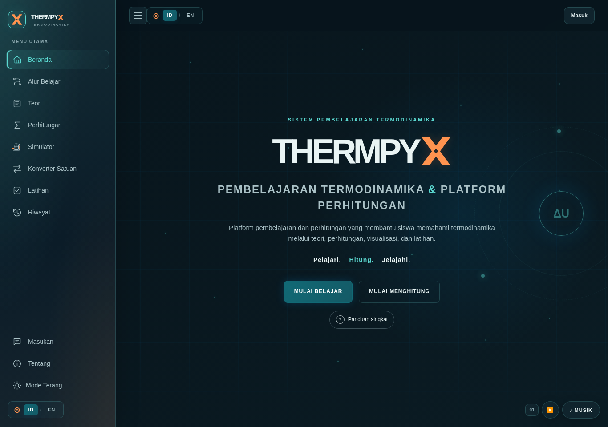

*Gambar 3.1. Tema gelap menggunakan latar navy dan aksen cyan/teal untuk identitas serta penekanan kontrol.*

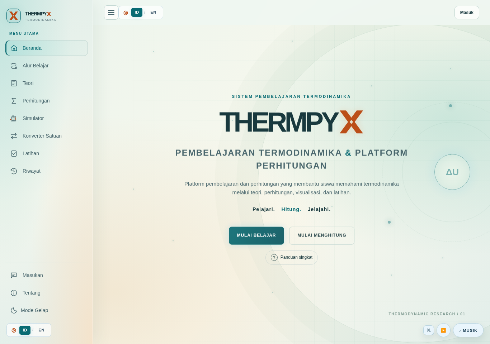

*Gambar 3.2. Tema terang mempertahankan identitas warna melalui lapisan latar dan permukaan konten yang berbeda.*

Navigasi memiliki ikon dan label, dengan informasi nama fitur saat interaksi. Pergantian tema menggunakan transisi melingkar dari kontrol tema pada perangkat yang mendukungnya, serta perlu tetap menghormati pengurangan gerakan. Profil pengembang memakai kartu rotasi dengan aksesori sesuai anggota. Elemen tersebut berfungsi sebagai presentasi tim; bukan bagian model termodinamika.

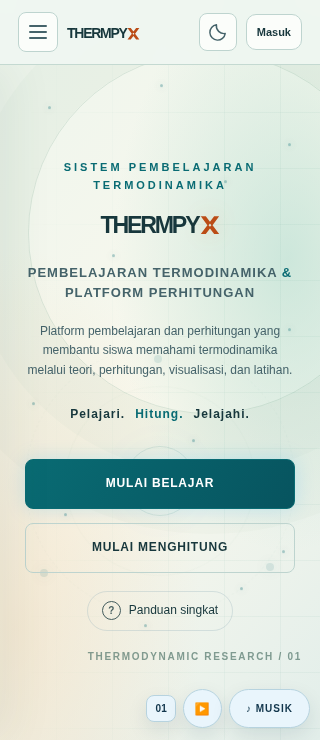

*Gambar 3.3. Penyesuaian tata letak pada layar kecil untuk mempertahankan keterbacaan dan akses navigasi.*

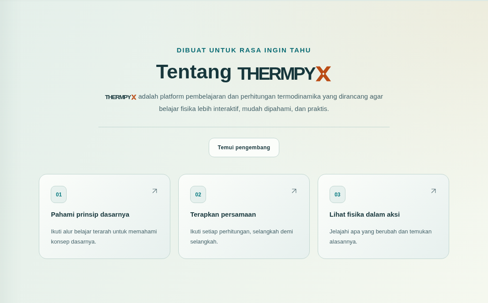

*Gambar 3.4. Bagian Tentang menghubungkan penjelasan platform dengan langkah belajar, perhitungan, dan simulasi.*

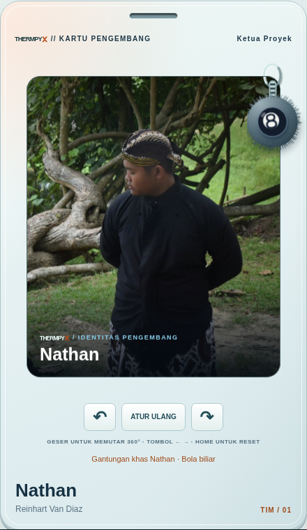

*Gambar 3.5. Profil pengembang sebagai identitas tim dan contoh penerapan komponen interaktif.*

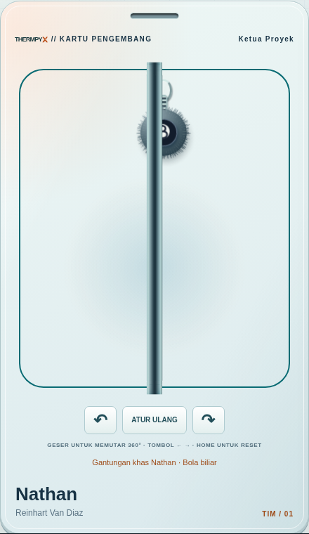

*Gambar 3.6. Pemeriksaan tampilan samping kartu rotasi untuk mengamati kontinuitas permukaan dan aksesori.*

## 3.5 Strategi Pengujian

Pemeriksaan memadukan pembacaan kode, contoh analitis, pengujian fungsi, dan peramban. Nilai acuan dipilih sebelum membandingkan keluaran. Pengujian input juga mencakup nilai tidak valid dan hasil numerik yang melampaui rentang. Pada alur akun dan kuis, fixture menggantikan layanan eksternal agar skenario gagal, pengiriman ulang, serta pergantian sesi dapat diperiksa tanpa membuat data produksi.

Emulator Rules merupakan lapisan berbeda karena benar-benar mengeksekusi aturan database. Hasil emulator tidak membuktikan bahwa aturan yang sama sudah terpasang di produksi. Demikian pula, keberhasilan antarmuka dengan fixture tidak membuktikan keberhasilan OAuth Google produksi. Setiap jenis bukti dipisahkan pada pembahasan hasil.

# BAB IV HASIL DAN PEMBAHASAN

## 4.1 Hasil Implementasi Pembelajaran

THERMPYX menyediakan hubungan langsung antara materi, alat hitung, dan aktivitas. Contohnya, pengguna dapat mempelajari hukum pertama, mencoba perubahan keadaan gas dalam silinder, lalu membandingkan kalor dan usaha dengan perubahan energi dalam. Kalkulator menampilkan satuan dan asumsi agar angka yang dihasilkan dapat ditafsirkan.

### 4.1.1 Materi dan Alur Belajar

Alur Belajar menyatukan tujuan, kegiatan membaca, eksperimen, dan kuis per topik. Halaman materi menyediakan penjelasan lanjutan, persamaan beserta asumsi, dan lima contoh soal pada setiap bab. Tautan langsung ke bagian materi mempertahankan ruang di bawah header agar judul tetap terlihat pada layar kecil.

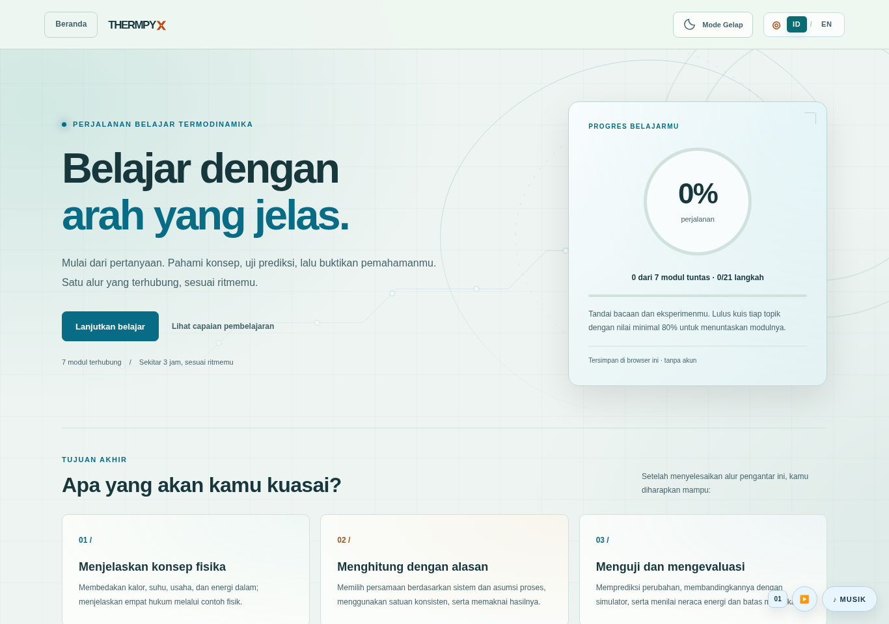

*Gambar 4.1. Halaman Alur Belajar menghubungkan pilihan topik dengan kegiatan dan progres belajar lokal.*

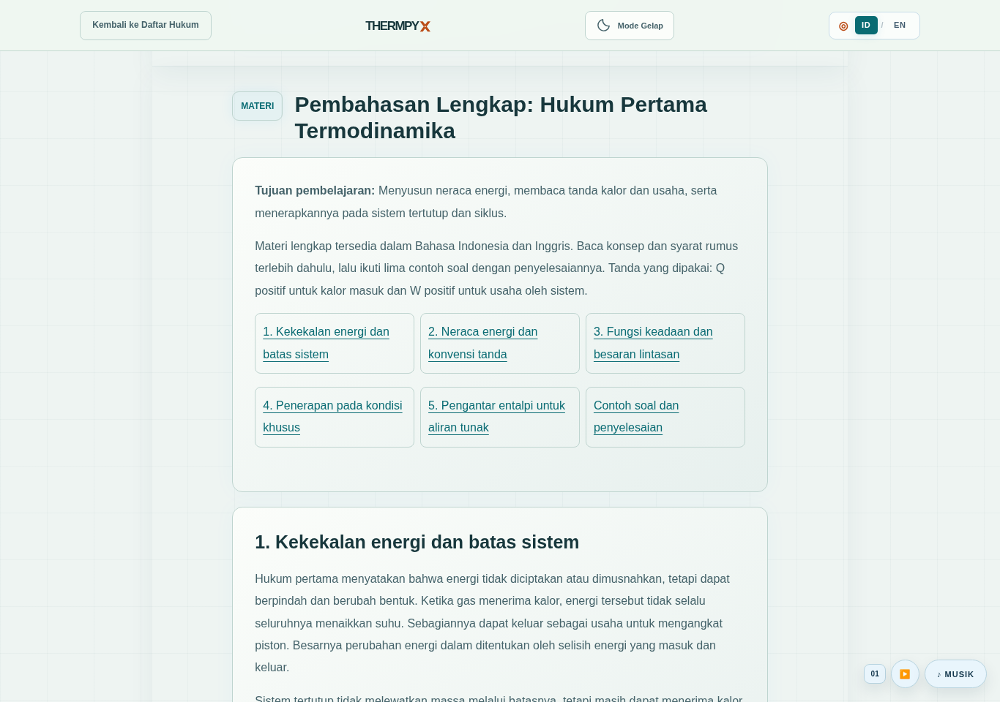

*Gambar 4.2. Contoh materi hukum pertama dengan penjelasan dan hubungan energi yang dapat dipelajari sebelum bereksperimen.*

### 4.1.2 Kalkulator dan Konverter

Kalkulator Hukum I menerima kalor dan usaha untuk menentukan perubahan energi dalam. Dengan Q = 500 J dan W = 200 J, keluaran ΔU = 300 J sesuai hasil substitusi analitis. Antarmuka menyertakan konvensi tanda sehingga hasil positif tidak disalahartikan sebagai temperatur atau energi total sistem.

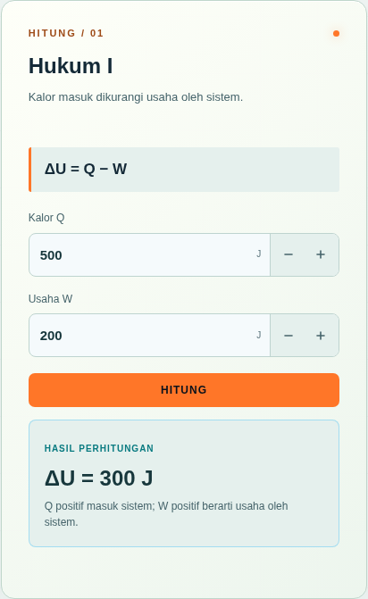

*Gambar 4.3. Penerapan neraca energi pada kalkulator Hukum I. Hasil dibaca bersama konvensi kalor masuk dan usaha oleh sistem.*

Konverter melengkapi perhitungan dengan sembilan kategori besaran. Konversi suhu diperlakukan sebagai pembacaan mutlak, sedangkan perhitungan selisih suhu tetap harus mengikuti definisi ΔT. Penyamaan satuan sebelum substitusi membantu menghindari kekeliruan, misalnya mencampurkan kPa dengan Pa atau liter dengan meter kubik.

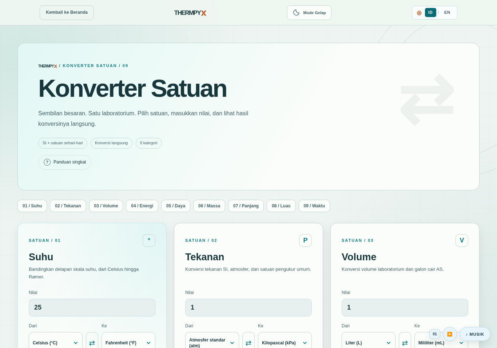

*Gambar 4.4. Konverter menyediakan pilihan satuan dan hasil langsung untuk membantu persiapan perhitungan.*

### 4.1.3 Simulator Proses

Simulator Hukum I menampilkan silinder-piston, kontrol keadaan, besaran energi, dan grafik P–V. Pengguna memilih proses, mengatur kondisi awal, menjalankan animasi, lalu menghentikannya sementara untuk mengamati perubahan. Contoh pada Gambar 4.5 menunjukkan keadaan antara saat simulasi dijeda; angka dalam tangkapan layar bukan hasil eksperimen laboratorium. Pengamatan perlu dikaitkan dengan batasan proses dan konvensi ΔU = Q − W.

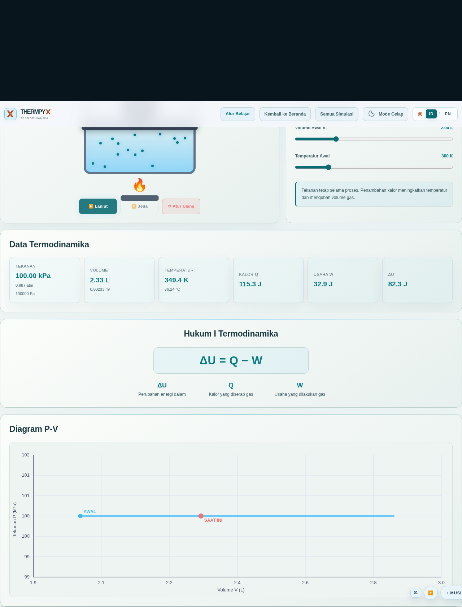

*Gambar 4.5. Tampilan simulator Hukum I saat proses dijeda, memperlihatkan model piston dan besaran yang terkait proses.*

### 4.1.4 Kuis dan Pembahasan

Kuis mandiri memberikan umpan balik setelah pengguna menjawab dan menyediakan rekap. Pada kuis langsung, setiap jawaban perlu dikonfirmasi tersimpan sebelum peserta berpindah. Skor benar bernilai 100, sedangkan salah atau kehabisan waktu bernilai nol. Durasi normal adalah 20 detik per soal pada client. Peringkat mempertimbangkan skor, kemudian total waktu jawaban ketika skor sama, menggunakan jawaban tersimpan sebagai sumber hasil.

Halaman leaderboard menyediakan tombol menuju halaman Periksa Jawaban setelah sesi berakhir. Halaman itu memperlihatkan jawaban pengguna, kunci, dan pembahasan; tersedia penyaring semua soal, benar, serta perlu dipelajari lagi. Pembahasan memakai snapshot ruang sehingga tidak mengambil alasan dari versi soal lain. Jika pembuat soal tidak memberikan pembahasan, antarmuka menyatakan hal tersebut dan tidak membuat alasan baru.

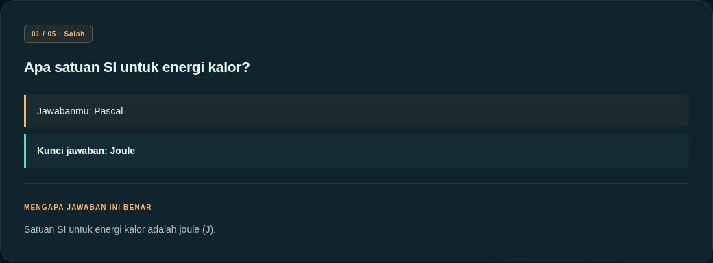

*Gambar 4.6. Contoh Periksa Jawaban pada latihan mandiri: jawaban pengguna dibandingkan dengan kunci dan penjelasan. Tangkapan ini tidak membuktikan koneksi kuis langsung produksi.*

Reaktor Energi adalah respons visual dari jawaban benar yang sudah tersimpan. Prisma menyediakan satu bantuan per peserta per ruang, jika diaktifkan guru, untuk menyingkirkan dua pilihan salah setelah konfirmasi backend. Keduanya tidak mengubah sistem skor 100/0. Penggunaan Prisma dicatat bagi host agar jawaban berbantuan dapat dikenali.

## 4.2 Hasil Pemeriksaan yang Dijalankan

Tabel berikut memuat hasil yang dijalankan langsung pada cabang publikasi dalam audit ini. Angka pemeriksaan berbeda dari jumlah skenario dan tidak dijumlahkan menjadi ukuran efektivitas belajar.

| Pemeriksaan | Hasil audit | Bukti dan batas |
| --- | --- | --- |
| Periksa Jawaban | 8 skenario lulus | `qa/test-answer-review.cjs`; peramban dengan kontrak Firebase tiruan, termasuk pembatasan sesi, jawaban pengguna, snapshot, bahasa, retry, dan rekap offline |
| Client Firebase | 58 assertion lulus | `qa/test-firebase-client.cjs`; fixture SDK dalam memori, tanpa permintaan produksi |
| Regresi kalkulator, suhu, riwayat | 20/20 pemeriksaan lulus | `qa/test-rev08.cjs`; meliputi contoh hukum dasar, konversi kelvin, dan perilaku riwayat |
| Validasi kalkulator | 4 skenario lulus | `qa/test-calculator-validation.cjs`; overflow, massa besar, suhu di bawah nol mutlak, dan pesan bilingual |
| Konverter satuan | 7 skenario lulus | `qa/test-unit-converter.cjs`; sembilan kategori, delapan skala suhu, konversi balik, dan penolakan input tidak valid |
| Alur Belajar | 357 pemeriksaan lulus | `qa/test-learning-path.cjs`; tujuh modul, progres, penyimpanan, tema, bahasa, dan akses papan ketik |
| Asesmen pembelajaran | 189 pemeriksaan lulus | `qa/test-learning-assessment.cjs`; 35 jawaban, penguasaan, bahasa, dan kuis campuran |
| Tema dan transisi | 42 pemeriksaan lulus | `qa/test-interface-theme.cjs`; peramban lokal |
| Tata letak About | 15 pemeriksaan lulus | `qa/test-about-layout.cjs`; peramban lokal |
| Pengenalan pengembang | 18 pemeriksaan lulus | `qa/test-developer-intro.cjs`; peramban lokal |
| Navigasi | 60 pemeriksaan lulus | `qa/test-navigation-layout.cjs`; peramban lokal |
| Kartu Developer | 40 pemeriksaan lulus | `qa/test-developer-card.cjs`; kontras, layar 320/1440 piksel, dua bahasa/tema, kontrol rotasi dan empat gantungan |
| Materi lengkap | 706 pemeriksaan lulus | `qa/test-theory-material.cjs`; tujuh bab, 35 contoh, nilai ilmiah, tautan, akses papan ketik dan tata letak |
| Kontrol kalkulator | 40 pemeriksaan lulus | `qa/test-calculator-stepper.cjs`; presisi, batas, keyboard dan tujuh persamaan |
| Alur kuis Firebase | 10 skenario lulus | `qa/test-firebase-live.cjs`; kontrak backend tiruan lokal, tanpa perubahan produksi |

Sebagai contoh, perhitungan kalor dengan 2 kg, 4200 J/(kg·K), dan kenaikan 10 K menghasilkan 84.000 J. Perhitungan usaha 100 kPa dari 2 m³ ke 5 m³ menghasilkan 300.000 J. Kasus isotermal 200 kPa, 2 L menjadi 4 L menghasilkan 100 kPa. Hasil cocok dengan substitusi analitis, tetapi belum menguji seluruh kombinasi input yang mungkin.

## 4.3 Bukti Terdokumentasi dan Perilaku Produksi

Repositori mencatat pengujian Rules pada emulator resmi melalui run GitHub Actions `38990392529`, sumber commit `9d00ffb`, sebanyak 9 skenario dan 345 pemeriksaan. Bukti tersebut terkait versi aturan yang hash-nya dicatat dalam dokumentasi proyek. Ini hasil CI yang sudah terdokumentasi, bukan pengujian emulator baru dalam audit ini. Perubahan isi Rules memerlukan pengujian ulang.

Dokumentasi juga mencatat laporan pengguna bahwa login Google, pembuatan/penggunaan soal, serta teman bergabung dan menjawab pada web aktif telah berhasil. Pernyataan tersebut diperlakukan sebagai laporan percobaan pengguna. Audit ini tidak melakukan login produksi atau menulis record untuk memverifikasinya ulang. Ketepatan leaderboard produksi, muat ulang semua data, dan isolasi antar-akun di produksi tidak disimpulkan dari laporan tersebut.

## 4.4 Keterbatasan dan Evaluasi

Kesesuaian contoh numerik menunjukkan implementasi benar untuk kasus yang diuji, tetapi tidak menetapkan ketelitian fisika seluruh simulator. Animasi mesin, partikel, dan aksesori adalah representasi. Model relatif entropi hukum ketiga serta faktor efisiensi contoh perlu dijelaskan ketika demonstrasi agar pengguna tidak menganggapnya data bahan nyata.

Kuis ditujukan untuk latihan kelas. Snapshot yang dapat dibaca anggota memuat informasi jawaban; tenggat berbasis client tidak menjadikannya sistem ujian dengan jaminan kerahasiaan kunci atau pengawasan waktu server menyeluruh. Ketergantungan jaringan juga dapat memengaruhi login dan sinkronisasi.

Evaluasi pembelajaran berikutnya dapat menggunakan pretest dan posttest yang mengukur capaian sama, disertai jumlah responden, prosedur, serta analisis yang transparan. Observasi usability dapat mencatat keberhasilan tugas dan kesulitan navigasi. Nilai, persentase peningkatan, atau tanggapan responden baru boleh dimasukkan setelah data dikumpulkan; hasilnya tidak boleh diturunkan hanya dari kelulusan tes perangkat lunak.

# BAB V PENUTUP

## 5.1 Kesimpulan

THERMPYX telah mengintegrasikan tujuh topik termodinamika ke dalam media web dengan materi, kalkulator, enam simulator, konverter, latihan, dan dukungan kuis langsung. Implementasi menggunakan persamaan dasar dengan asumsi tertentu serta menyediakan pembahasan jawaban sebagai umpan balik. Pemeriksaan yang dijalankan dalam audit memenuhi hasil harapan pada cakupan masing-masing. Bukti tersebut mendukung kesiapan fungsi yang diperiksa, sedangkan validasi keseluruhan produksi dan dampak pembelajaran tetap memerlukan evaluasi lanjutan.

## 5.2 Saran

Pengembangan berikutnya diarahkan pada peninjauan materi oleh dosen, perluasan kasus uji fisika, pengujian lintas perangkat dan aksesibilitas, serta evaluasi kelas berbasis data. Evaluasi tersebut dapat dirancang bersama mahasiswa dan dosen Program Studi Bilingual Pendidikan Fisika, Universitas Negeri Medan. Panduan penggunaan sebaiknya mempertahankan penjelasan satuan, kesepakatan tanda, serta batas model. Dokumentasi rilis perlu mencatat commit dan hasil pemeriksaan agar versi yang dinilai sesuai dengan versi yang didemonstrasikan.
