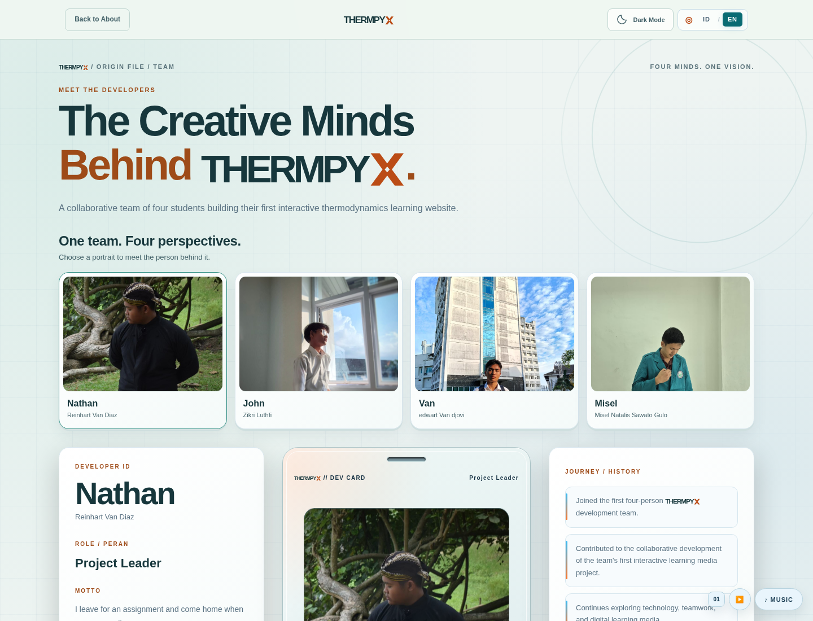
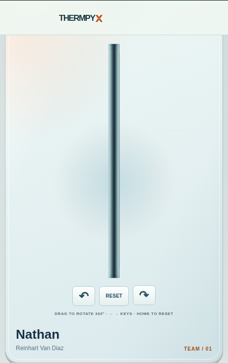
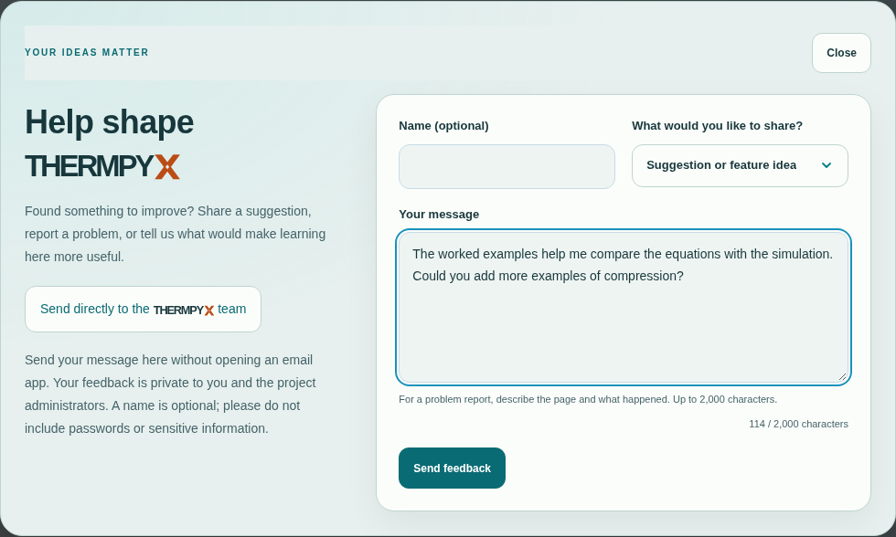

# CHAPTER I INTRODUCTION

## 1.1 Background

Thermodynamics examines energy transformations and the limits of physical processes. When studying this subject, students need to distinguish energy stored as a state property from energy transferred across a system boundary as heat or work. They must also understand that the use of an equation depends on the type of system, the process, the units, and the sign convention. For example, the equation for work at constant pressure cannot be applied indiscriminately to every change in volume (Urone and Hinrichs, 2022 [B1]; Yan, 2022 [B2]). Recent diagnostic work also documents difficulties in connecting internal energy, heat and work across process contexts (Brundage et al., 2024a [J2]; Brundage et al., 2025 [J6]).

A web-based learning environment can bring conceptual explanations, worked examples, and visual representations together. Users can read an explanation, predict an outcome, vary the parameters, and compare the displayed result with the governing equation. Quiz feedback and answer explanations provide opportunities to examine why a particular answer is correct. Research on scaffolded simulations and self-regulated learning provides a rationale for this design (Ajayan et al., 2025 [J8]; Sapriati et al., 2023 [J9]); it does not establish the effectiveness of this particular application.

THERMPYX was developed as a Thermodynamics course project in the Bilingual Physics Education Study Program at Universitas Negeri Medan. The project aims to provide a browser-accessible learning resource that connects theory, calculations, and representations of physical processes. Its futuristic appearance, theme options, and interactive team profiles contribute to the user experience; the academic emphasis remains on conceptual accuracy and reasoning.

## 1.2 Problem Statements

1. How can thermodynamics material be presented systematically through a website?
2. How can fundamental equations be implemented in calculators and simulations with clearly stated assumptions?
3. How can practice activities provide feedback and explanations of the answers?
4. How can the application's functions be checked and the limitations of those checks be reported?

## 1.3 Objectives and Expected Benefits

The project aims to produce a learning resource that connects seven topics, supports fundamental calculations, provides visual activities and practice, and documents repeatable software checks. For students, the application offers opportunities for independent exploration. For teachers, the question bank and live quiz provide options for classroom activities. For the development team, the project provides experience in translating physical models into user interfaces and program logic.

These benefits are design objectives. This report does not conclude that the application improves students' grades, motivation, or understanding, because no learning research data supporting such conclusions are available.

## 1.4 Scope and Limitations

The material covers heat and temperature, the zeroth law, work and energy, the first law, thermodynamic processes, the second law, and the third law. The calculators use simplified models; some relationships assume ideal gases, constant specific heat capacities, or reversible processes. The particle and apparatus simulations are illustrative representations rather than laboratory measurements or molecular simulations with experimentally established accuracy.

The software audit examines functionality and selected numerical results. Classroom research, testing on every device, a formal accessibility audit, and production load measurements are outside the results reported here. Locally stored learning progress is neither an academic certification nor a browser-tamper-resistant examination mechanism.

# CHAPTER II THEORETICAL FOUNDATIONS

## 2.1 Systems, State Properties, Heat, and Work

A system is the part selected for analysis; its surroundings lie outside the system boundary. Unit conventions follow the [BIPM SI Brochure](https://www.bipm.org/en/publications/si-brochure). The conceptual explanations should also be read alongside the thermodynamics textbooks used in the course. No mass crosses the boundary of a closed system. Internal energy, temperature, pressure, and volume are state properties. Heat and work describe modes of energy transfer and should therefore not be treated as quantities of energy stored within a body.

For a closed system, the energy balance used in the basic THERMPYX tools is:

\[
\Delta U=Q-W.
\]

The sign convention takes heat transferred into the system as positive and work done by the system as positive. This form neglects changes in macroscopic kinetic and potential energy. For example, if a system receives 500 J of heat and does 200 J of work, its internal energy increases by 300 J.

## 2.2 Temperature and the Zeroth Law

The zeroth law states the transitive nature of thermal equilibrium: if A is in thermal equilibrium with B, and B is in thermal equilibrium with C, then A is in thermal equilibrium with C. Thermal equilibrium means that there is no net heat transfer caused by a temperature difference.

The calculator associated with the zeroth-law topic uses an example involving the mixing of two samples:

\[
T_{eq}=\frac{m_1T_1+m_2T_2}{m_1+m_2}.
\]

This equation follows from an energy balance when the samples have equal specific heat capacities, the system is isolated, and no phase change occurs. The mixing temperature is therefore an additional application of energy conservation, rather than a general equation expressing the zeroth law. Mixing 2 kg at 80 °C with 3 kg at 20 °C gives an equilibrium temperature of 44 °C. If the specific heat capacities differ, the general expression must include each sample's heat capacity.

## 2.3 Sensible Heat and Boundary Work

For a constant specific heat capacity, sensible heat is calculated using:

\[
Q=mc\Delta T,\qquad \Delta T=T_2-T_1.
\]

Mass is expressed in kg, specific heat capacity in J/(kg·K), and heat in joules. A temperature difference has the same numerical value in kelvin and degrees Celsius. This equation does not include latent heat during a phase change. The simulator uses representative specific heat capacities of 4200 J/(kg·K) for water, 900 J/(kg·K) for aluminium, 450 J/(kg·K) for iron, and 385 J/(kg·K) for copper. These values are treated as constant during the activity.

Boundary work at constant pressure is calculated as:

\[
W=P(V_2-V_1).
\]

Under the project's sign convention, expansion produces positive work and compression produces negative work. The work calculator converts kPa to Pa when volume is expressed in m³. In the process tool, which uses litres, 1 kPa·L equals 1 J. When pressure varies, the general quasistatic relationship is \(W=\int P\,dV\), with the appropriate pressure at the system boundary.

## 2.4 Ideal-Gas Processes

The ideal-gas model uses \(PV=nRT\). The relationships implemented in the process calculator are summarised below.

| Process | Conditions and implemented relationship | Conditions of applicability |
| --- | --- | --- |
| Isothermal | \(P_1V_1=P_2V_2\) | Ideal gas at constant temperature |
| Isobaric | \(W=P\Delta V\) | Constant pressure |
| Isochoric | \(\Delta V=0\), so boundary work is zero | Constant volume; this does not mean that every form of work must be zero |
| Reversible adiabatic | \(P_1V_1^\gamma=P_2V_2^\gamma\) | Ideal gas, reversible process, and a specific heat capacity ratio treated as constant |

For an ideal gas undergoing an isothermal process, the change in internal energy is zero. Under the same assumptions, the energy balance gives \(Q=W\). An adiabatic process has no heat transfer; the relationship \(PV^\gamma\) is not valid for every adiabatic process without the additional reversibility condition.

## 2.5 Entropy and the Second Law

The second law constrains the direction of processes and the conversion of energy. A system's entropy change can be positive or negative, but entropy generation is nonnegative. The total entropy change of an isolated system is nonnegative. The THERMPYX calculator uses:

\[
\Delta S=Q_{rev}/T.
\]

This expression applies to reversible heat transfer at a constant absolute temperature. Temperature must be expressed in kelvin and must be greater than zero. For example, 500 J transferred reversibly at 250 K corresponds to an entropy change of 2 J/K. For two bodies with constant heat capacities, the simulator uses the sum \(C_h\ln(T_{hf}/T_{hi})+C_c\ln(T_{cf}/T_{ci})\), with all temperatures expressed in kelvin.

The Carnot efficiency limit is \(\eta_C=1-T_c/T_h\), where \(T_h>T_c\). The simulator sets its illustrative efficiency to 80% of the Carnot limit and uses an illustrative heat input of 1000 J. The 80% factor is a program design choice, not a measured result or a universal law for real engines.

## 2.6 The Third Law

For a perfect crystal with a unique ground state, entropy approaches zero as temperature approaches 0 K. The temperature conversion used is \(T(K)=T(°C)+273.15\). Converting temperature does not, by itself, determine a material's absolute entropy.

The third-law simulator uses the relative entropy model \(S/S_0=(T/T_0)^3\) for visualisation, together with representations of particle motion and order. This expression must not be presented as a universal equation for all materials and temperatures. The displayed degree of order is not a measurement of crystal structure. Particle motion is also not a quantum simulation and must not be used to conclude that all motion disappears at absolute zero.

## 2.7 Theory Source Mapping

The revised theoretical discussion is checked against two open textbooks and five recent open-access journal articles. Table 2.1 identifies these seven core references. The textbook sources provide standard definitions, equations and assumptions; the journal sources provide recent diagnostic or theoretical comparisons. These references were consulted for the present revision. They are not presented as a reconstruction of the team's undocumented original reading history.

*Table 2.1. Five recent journal articles and two open textbooks used to check the theoretical discussion.*

| Source | Scope in this report | Identifier | Official download |
| --- | --- | --- | --- |
| [J1] Volfson et al. (2026) | Heat transfer, internal energy and thermal-process misconceptions. | [DOI: 10.1103/q4n2-d2w3](https://doi.org/10.1103/q4n2-d2w3) | [Open-access PDF](https://journals.aps.org/prper/pdf/10.1103/q4n2-d2w3) |
| [J2] Brundage et al. (2024a) | Internal energy, work, heat transfer and process-dependent reasoning. | [DOI: 10.1103/PhysRevPhysEducRes.20.010115](https://doi.org/10.1103/PhysRevPhysEducRes.20.010115) | [Open-access PDF](https://journals.aps.org/prper/pdf/10.1103/PhysRevPhysEducRes.20.010115) |
| [J3] Brundage et al. (2024b) | Entropy, the second law and the system boundary. | [DOI: 10.1103/PhysRevPhysEducRes.20.020110](https://doi.org/10.1103/PhysRevPhysEducRes.20.020110) | [Open-access PDF](https://journals.aps.org/prper/pdf/10.1103/PhysRevPhysEducRes.20.020110) |
| [J4] Brundage and Singh (2023) | Conceptual assessment of first- and second-law understanding. | [DOI: 10.1103/PhysRevPhysEducRes.19.020112](https://doi.org/10.1103/PhysRevPhysEducRes.19.020112) | [Open-access PDF](https://journals.aps.org/prper/pdf/10.1103/PhysRevPhysEducRes.19.020112) |
| [J5] Van Vu and Saito (2025) | Third-law unattainability under the studied classical and quantum dynamics. | [DOI: 10.1103/l6b9-rg1j](https://doi.org/10.1103/l6b9-rg1j) | [Open-access PDF](https://journals.aps.org/prx/pdf/10.1103/l6b9-rg1j) |
| [B1] Urone and Hinrichs (2022), *College Physics 2e* | Temperature, heat, energy transfer, thermodynamic processes and entropy. | Digital ISBN 978-1-951693-60-2; no DOI listed. | [Publisher](https://openstax.org/details/books/college-physics-2e) · [Legal PDF](https://assets.openstax.org/oscms-prodcms/media/documents/college-physics-2e_-_WEB.pdf) |
| [B2] Yan (2022), *Introduction to Engineering Thermodynamics* | Engineering definitions, closed-system energy balances, work and the second law. | No ISBN or DOI listed in the inspected publisher record. | [Publisher](https://pressbooks.bccampus.ca/thermo1/) · [Legal PDF](https://pressbooks.bccampus.ca/thermo1/open/download?type=pdf) |

All five articles fall within 2022–2026 and were available as publisher-hosted PDFs when checked on 18 October 2026. The two books are the 2022 editions available from their publishers. No DOI was listed for either book, and no ISBN was listed for Yan's book. The OpenStax digital ISBN is 978-1-951693-60-2. Each book's publisher linked CC BY-NC-SA 4.0 terms at verification. Download links point to the publishers rather than unauthorised copies.

*Table 2.2. Mapping the seven website topics to foundational and recent supporting references.*

| Website theory topic | Textbook foundation | Recent core article(s) | Supported content and limits |
| --- | --- | --- | --- |
| Heat and temperature | B1: chapters 13–14; B2: §4.2 | J1 | Separate heat transfer from stored internal energy; discuss heat capacity with its assumptions. Q = mcΔT assumes constant specific heat and no phase change; visual particles are illustrative. |
| Zeroth law | B2: §2.2.2; B1: §13.1 | J1 (heat-transfer misconceptions context only) | Thermal equilibrium is transitive and underlies temperature comparison; the direct law source is B2. A mixed-sample equilibrium temperature additionally requires an energy balance and heat-capacity assumptions; it is not the zeroth-law equation. |
| Work and energy | B2: §§4.1, 4.3; B1: §§15.1–15.2 | J2 | Internal energy is a state property while heat/work depend on the process; pressure-volume work needs an identified path. W = PΔV assumes constant relevant boundary pressure; expansion is positive under the project convention. |
| First law | B2: §4.4; B1: §15.1 | J2, J4 | For a closed system with negligible macroscopic kinetic/potential changes, ΔU = Q − W using heat-in/work-by-system signs. These references support the concept and diagnosis; they do not show the website improved learning. |
| Thermodynamic processes | B2: §§3.1, 4.3–4.4, 6.7.4; B1: §15.2 | J2, J4 | Distinguish isothermal, isobaric, isochoric and reversible adiabatic conditions and path-dependent work. PV^γ = constant requires an ideal gas, reversible adiabatic process and effectively constant heat-capacity ratio. |
| Second law and entropy | B2: §§6.3–6.5; B1: §§15.3–15.6 | J3 | Distinguish system entropy change from entropy generation and state the reversible-isothermal conditions for ΔS = Qrev/T. Carnot efficiency uses absolute temperatures and is an upper bound for the specified reservoir pair; the program’s 80% factor is illustrative. |
| Third law | B2: §2.2.2 (absolute-temperature background only); B1: §15.4 (absolute-zero/Carnot background only) | J5 | Section III.B distinguishes the Nernst/Planck entropy formulation from unattainability. The cooling research provides limits on reaching absolute zero, not a universal S ∝ T³ material law. The perfect-crystal entropy statement differs from the unattainability principle; the cited introductory textbook sections do not derive the full third law. |

For the third law, Van Vu and Saito (2025) [J5] explicitly distinguish the Nernst/Planck entropy formulations from the unattainability principle; their quantitative investigation concerns unattainability. The perfect-crystal entropy statement and the impossibility of reaching absolute zero must therefore be identified separately. Neither this paper nor the cited introductory textbook sections establishes the website's cubic relative-entropy illustration as a universal material law.

## 2.8 Recent Research and Learning-Design Comparisons

The recent diagnostic literature supports careful attention to conceptual boundaries. Volfson et al. (2026) [J1] examine students' understanding of thermal processes in kinetic-molecular terms. Brundage, Meltzer and Singh (2024a, 2024b) [J2, J3] examine difficulties involving internal energy, work, heat, entropy and the second law. Brundage and Singh (2023) [J4] describe a conceptual survey instrument. These studies motivate explanations and questions that ask for reasoning; THERMPYX's own practice questions must not be described as that validated instrument.

Problem characteristics and opportunities for discussion also matter. Brundage et al. (2025) [J6] examine how properties of thermodynamics problems relate to student responses. Velasco et al. (2022) [J7] analyse the development of entropy reasoning among peers through coordination class theory. These findings support varying the representation of a concept and discussing the reasoning behind a saved answer. J2–J4 and J6 belong to a related research programme; they are not four independent trials showing the effectiveness of this website. The 2024 errata to J2 and J4 clarify split administrations of the survey, so the papers must not be summarised as showing that every student answered all 78 items.

Interactive simulations provide comparison cases for learning design. Ajayan et al. (2025) [J8] study scaffolded simulation activities in general chemistry. Their work provides a rationale for guided prediction, repeated trials and feedback around a simulation, while its disciplinary context differs from university thermodynamics. Sapriati et al. (2023) [J9] review virtual laboratories and self-regulated learning; this supports the design rationale for planning, monitoring and reflection, rather than proving that a local progress checkbox demonstrates mastery. Sanjari and Manouchehri (2024) [J10] investigate mathematical modelling with simulations in elementary mathematics. Their study is used only to compare ways of connecting parameter changes, visual representations and explanations.

The ten articles inform conceptual presentation and the proposed evaluation. They do not supply measured learning gains for THERMPYX. Establishing such gains would require a separate classroom study with appropriate participants, measures and analysis.

# CHAPTER III DEVELOPMENT METHOD AND DESIGN

## 3.1 Development Approach

The development process follows the iterative cycle reflected in the project's artefacts and revision history: identifying requirements, preparing content and calculation models, building the interface, running checks, and addressing the findings. Each new feature is assessed in relation to its learning purpose, conceptual accuracy, and usability.

The main requirements are organised into a sequence of reading, predicting, experimenting, calculating, and checking understanding. The recommended order begins with heat and temperature, followed by the zeroth law, work and energy, the first law, thermodynamic processes, the second law, and the third law. Users can also select topics freely when reviewing the material.

## 3.2 Application Architecture

The frontend is a static website built with HTML, CSS, and JavaScript. Serving it requires no build step or npm installation. The `app.html` page provides a navigation shell that allows music playback to continue while the page content changes. Graphs and animations use Canvas and interface elements. Certain features depend on external network resources, including fonts, video material, and account services.

The active backend uses [Firebase Authentication](https://firebase.google.com/docs/auth) and [Realtime Database](https://firebase.google.com/docs/database) through a shared client module. Teachers sign in with Google. Quiz participants use Firebase anonymous identities, a room code, and a nickname. An anonymous identity is not treated as a teacher account. Cloud question banks and flashcard collections are separated by owner. Database Rules check access and data structure, while the frontend also provides validation and failure messages.

A quiz room stores a snapshot of its questions when it is created. Subsequent edits to the question bank should therefore not change the questions in an existing room. Legacy Supabase files and SQL remain in the repository as migration records; their presence does not mean that the active application uses two backends simultaneously.

## 3.3 Features and Storage

| Component | Function and storage |
| --- | --- |
| Learning Path | Seven modules, learning objectives, activities, and browser-local progress |
| Theory | Seven topics with extended explanations and 35 worked examples |
| Calculators | Seven tools with equations, units, and stated assumptions |
| Simulators | Six simulators: the zeroth, first, second, and third laws; heat and temperature; and work and energy |
| Unit Converter | Nine categories: temperature, pressure, volume, energy, power, mass, length, area, and time |
| Independent Practice | Seven topics with five questions each; mixed practice selects three questions per topic |
| Live Quiz | Rooms, participants, answers, results, and assistance through Firebase |
| Flashcards | Local editing and import; private cloud collections for Google accounts |
| History | Up to 50 recent learning results stored in the browser |

Users mark reading and activity completion themselves. Topic-quiz mastery requires a score of at least 80%. A module is complete when its reading, activity, and quiz requirements are met. These indicators support independent learning management, with the limitation that users can clear or modify locally stored data.

Flashcard import processes PDF and DOCX files on the device, with an 8 MB file-size limit, a maximum of 32 PDF pages, and a maximum of 100 cards. The import workflow does not upload the original file. Users review and edit the extracted text before saving cards. Scanned documents still require optical character recognition (OCR). Teacher-authored content and imported material are not translated automatically.

The feedback revision replaces the email-draft workflow with submission from within the website to Firebase. The form must confirm that the backend has accepted the submission before displaying a success message, and it must retain the user's draft if submission fails. The new feedback path requires its own validated Database Rules. Publishing the updated Rules is a separate deployment prerequisite; implementing the form and testing it locally do not establish successful production delivery.

## 3.4 Interface and Interaction Design

The visual identity uses a cyan/teal primary palette and amber/orange supporting colours. The dark theme uses navy surfaces, while the light theme uses light surfaces with distinct levels of visual emphasis. The palette defines the dark-theme primary colour as `#5bd8d0` and the light-theme primary colour as `#096b73`. The secondary colours are `#ffb367` in the dark theme and `#9e4b18` in the light theme. The darker secondary colour on light surfaces improves the readability of small labels.

*Figure 3.1. The dark theme uses a navy background and cyan/teal accents to establish the visual identity and emphasise controls.*

*Figure 3.2. The light theme retains the visual identity through layered backgrounds and differentiated content surfaces.*

The navigation provides icons, labels, and feature-name tooltips during interaction. On supported devices, changing the theme uses a circular transition originating at the theme control; reduced-motion preferences must also be respected. Developer profiles use rotating cards. In the current revision, the decorative keychains are removed while the profile and rotation interactions are retained. These components present the team and do not form part of a thermodynamic model.

*Figure 3.3. The layout adapts to a small screen to maintain readability and access to navigation.*

*Figure 3.4. The About section connects the platform description with learning, calculation, and simulation activities.*

*Figure 3.5. Developer profiles identify the team and demonstrate interactive interface components. The updated screenshot shows the current accessory-free card.*

*Figure 3.6. The current rotating card viewed from the side, showing a continuous rim without a decorative keychain.*

The supplied screenshots are retained where relevant, while Figures 3.5–3.7 show the revised interface. Text embedded in retained screenshots is part of the original bilingual interface; the narrative, headings, tables and figure captions are in English.

*Figure 3.7. The revised feedback popup submits from within the website. This screenshot shows an unsent draft; it is not evidence of a production message being delivered.*

## 3.5 Testing Strategy

The checks combine code review, analytical examples, functional testing, and browser testing. Reference values are selected before the displayed results are compared. Input testing also covers invalid values and numerical results outside the supported range. In account and quiz workflows, fixtures replace external services so that failures, repeated submissions, and session changes can be examined without creating production records.

Rules emulator testing is a separate layer because it executes the actual database rules. Passing an emulator test does not prove that the same rules have been deployed to production. Similarly, a successful interface test using fixtures does not demonstrate successful production Google OAuth. These types of evidence are distinguished in the discussion of results.

# CHAPTER IV RESULTS AND DISCUSSION

## 4.1 Implementation of the Learning Features

THERMPYX connects theory, calculation tools, and activities. For example, users can study the first law, explore changes in the state of a gas inside a cylinder, and compare heat and work with the change in internal energy. The calculators display units and assumptions to support the interpretation of numerical results.

### 4.1.1 Theory and Learning Path

The Learning Path brings together objectives, reading activities, experiments, and topic quizzes. The Theory page provides extended explanations, equations with their assumptions, and five worked examples in each chapter. Direct links to sections leave space beneath the header so that headings remain visible on small screens.

*Figure 4.1. The Learning Path connects topic selection with activities and browser-local learning progress.*

*Figure 4.2. First-law material provides explanations and energy relationships to study before experimenting.*

### 4.1.2 Calculators and Unit Converter

The first-law calculator accepts heat and work to determine the change in internal energy. With Q = 500 J and W = 200 J, the output ΔU = 300 J agrees with direct analytical substitution. The interface states the sign convention so that a positive result is not mistaken for a temperature or the system's total energy.

*Figure 4.3. Application of the energy balance in the first-law calculator. The result is interpreted using the conventions for heat transferred into the system and work done by the system.*

The unit converter supports calculations in nine categories of physical quantities. Temperature conversion treats the input as a temperature reading, while calculations involving a temperature difference must still follow the definition of ΔT. Converting to consistent units before substitution helps prevent errors such as mixing kPa with Pa or litres with cubic metres.

*Figure 4.4. The converter provides unit selections and immediate results to help users prepare calculations.*

### 4.1.3 Process Simulators

The first-law simulator displays a cylinder and piston, state controls, energy quantities, and a P–V graph. Users select a process, set the initial conditions, start the animation, and pause it to observe changes. Figure 4.5 shows an intermediate state while the simulation is paused; the numbers in the screenshot are not laboratory results. Observations should be interpreted in relation to the process assumptions and the convention ΔU = Q − W.

*Figure 4.5. The first-law simulator paused during a process, showing the piston model and quantities associated with the process.*

### 4.1.4 Quizzes and Answer Explanations

Independent practice provides feedback after users answer and offers a results summary. In a live quiz, each answer must be confirmed as saved before the participant moves on. A correct answer earns 100 points, while an incorrect answer or a timeout earns zero. The normal client-side time limit is 20 seconds per question. Rankings use the score and then the total answer time when scores are equal, with stored answers as the source of results.

After a session ends, the leaderboard provides a button leading to the Check Answers page. This page displays the user's answer, the correct answer, and the explanation, with filters for all questions, correct answers, and questions requiring further study. Explanations use the room snapshot to avoid retrieving an explanation from another version of a question. If the question author did not provide an explanation, the interface states this rather than generating a new reason.

*Figure 4.6. An example of Check Answers in independent practice: the user's answer is compared with the answer key and explanation. This screenshot does not establish production live-quiz connectivity.*

Reactor Energy provides visual feedback for correct answers that have been confirmed as saved. When enabled by the teacher, Prism offers one assist per participant per room and removes two incorrect options after backend confirmation. Neither feature changes the 100/0 scoring system. Prism use is recorded for the host so that assisted answers can be identified.

## 4.2 Recorded Software Checks

The table below translates the audit results documented in the supplied report. The audit was conducted on the publication branch. These are recorded results, not a claim that every listed suite was rerun during the preparation of this English edition. Check counts differ from scenario counts and must not be added together as a measure of learning effectiveness.

| Check | Recorded audit result | Evidence and limitations |
| --- | --- | --- |
| Check Answers | 8 scenarios passed | `qa/test-answer-review.cjs`; browser tests using a simulated Firebase contract, covering session restrictions, user answers, snapshots, language, retries, and offline summaries |
| Firebase client | 58 assertions passed | `qa/test-firebase-client.cjs`; in-memory SDK fixtures, with no production requests |
| Calculator, temperature, and history regression | 20/20 checks passed | `qa/test-rev08.cjs`; examples involving the basic laws, kelvin conversion, and history behaviour |
| Calculator validation | 4 scenarios passed | `qa/test-calculator-validation.cjs`; overflow, large masses, temperatures below absolute zero, and bilingual messages |
| Unit converter | 7 scenarios passed | `qa/test-unit-converter.cjs`; nine categories, eight temperature scales, round-trip conversions, and invalid-input rejection |
| Learning Path | 357 checks passed | `qa/test-learning-path.cjs`; seven modules, progress, storage, themes, languages, and keyboard access |
| Learning assessment | 189 checks passed | `qa/test-learning-assessment.cjs`; 35 answers, mastery, languages, and mixed quizzes |
| Themes and transitions | 42 checks passed | `qa/test-interface-theme.cjs`; local browser tests |
| About layout | 15 checks passed | `qa/test-about-layout.cjs`; local browser tests |
| Developer introduction | 18 checks passed | `qa/test-developer-intro.cjs`; local browser tests |
| Navigation | 60 checks passed | `qa/test-navigation-layout.cjs`; local browser tests |
| Developer cards | 40 checks passed | `qa/test-developer-card.cjs`; contrast, 320/1440-pixel screens, both languages and themes, rotation controls, and the four keychains present in the audited version. The keychain checks describe the earlier version and do not validate the revised accessory-free cards. |
| Complete theory material | 706 checks passed | `qa/test-theory-material.cjs`; seven chapters, 35 examples, scientific values, links, keyboard access, and layout |
| Calculator controls | 40 checks passed | `qa/test-calculator-stepper.cjs`; precision, limits, keyboard use, and seven equations |
| Firebase quiz workflow | 10 scenarios passed | `qa/test-firebase-live.cjs`; simulated local backend contract, with no production changes |

For example, the heat calculation with a mass of 2 kg, a specific heat capacity of 4200 J/(kg·K), and a temperature increase of 10 K gives 84,000 J. The work calculation at 100 kPa for a volume change from 2 m³ to 5 m³ gives 300,000 J. An isothermal case with an initial pressure of 200 kPa and a volume change from 2 L to 4 L gives a final pressure of 100 kPa. These results agree with analytical substitution, but they do not cover every possible input combination.

## 4.3 Documented Evidence and Production Behaviour

The repository records Rules testing using the official emulator in GitHub Actions run `38990392529`, from source commit `9d00ffb`, with 9 scenarios and 345 checks. This evidence applies to the rules version whose hash is recorded in the project documentation. It is previously documented continuous integration evidence, not a new emulator run conducted for this report. Changes to the Rules require a new test run.

The documentation also records the user's report that Google sign-in, question creation and use, and a friend's participation and answering on the live website were successful. These statements are treated as user-reported trial results. The audit did not perform production sign-in or create records to verify them independently. The report does not infer production leaderboard accuracy, reliable reloading of all data, or cross-account isolation from those statements.

The feedback revision introduces a separate Rules requirement. The earlier Rules evidence and user-reported quiz trial do not establish that the new feedback path is published or accepts submissions in production. Production feedback availability must be checked after the updated Rules are deployed, without treating a local fixture or emulator result as proof of delivery.

For the current revision, the official Realtime Database emulator completed 10 scenarios and 394 checks on 18 October 2026. The same final Rules also passed [GitHub Actions run 39111469190](https://github.com/thermpyx/thermpyxgsekawan/actions/runs/39111469190) from source commit `332ad51`, with 10 scenarios and 394 checks. The tested Rules have SHA-256 `8fe7f0f99ce85713b1656b488acd91843cf1d18ffa3c8c14e3474a2b2c12c12b`. Additional current checks passed: 83 Firebase-wrapper assertions, 21 direct-feedback checks, 22 feedback-modal checks, 42 developer-card checks and 19 developer-entrance checks. The accessory-free developer screenshots in this report show this revision. These are development and emulator results; no production feedback was submitted during testing.

## 4.4 Limitations and Further Evaluation

Agreement in the numerical examples supports implementation correctness for the tested cases; it does not establish the physical accuracy of every simulator. Engine and particle animations are representations. During demonstrations, the third-law relative entropy model and the illustrative efficiency factor should be explained so that users do not mistake them for measured material data.

The quiz is intended for classroom practice. Snapshots readable by room members contain answer information. A client-side deadline does not provide a high-stakes examination system with guaranteed answer-key confidentiality or comprehensive server-side timing enforcement. Network dependencies can also affect sign-in and synchronisation.

Further learning evaluation could use pretests and posttests measuring the same outcomes, accompanied by a transparent account of the participants, procedures, and analysis. Usability observations could record task completion and navigation difficulties. Grades, percentage improvements, and participant responses should be reported only after data have been collected; they cannot be inferred from passing software tests.

# CHAPTER V CONCLUSIONS AND RECOMMENDATIONS

## 5.1 Conclusions

THERMPYX integrates seven thermodynamics topics into a web-based learning resource with theory material, calculators, six simulators, a unit converter, practice activities, and live-quiz support. It implements fundamental equations under stated assumptions and provides answer explanations as feedback. The audit documented in the supplied report met the expected results within the scope of the recorded checks. That evidence supports the functions examined, while full production validation and the evaluation of learning outcomes require further work. The current revision removes developer keychains and introduces an in-site feedback workflow whose production availability depends on deploying the associated Database Rules.

## 5.2 Recommendations

Further development should include a lecturer's review of the material, additional physics test cases, cross-device and accessibility testing, and classroom evaluation based on collected data. That evaluation could be designed with students and lecturers in the Bilingual Physics Education Study Program at Universitas Negeri Medan. User guidance should continue to explain units, sign conventions, and model limitations. Release documentation should record the commit and verification results so that the assessed version corresponds to the version demonstrated.

# REFERENCES

## Journal articles

**[J1]** Volfson, A., Lankry, O., & Ben Abu, Y. (2026). Nature of heat inventory: Assessing students’ understanding of thermal processes in kinetic molecular terms. *Physical Review Physics Education Research, 22*(2), 020111. [https://doi.org/10.1103/q4n2-d2w3](https://doi.org/10.1103/q4n2-d2w3). [Open-access publisher PDF](https://journals.aps.org/prper/pdf/10.1103/q4n2-d2w3).

**[J2]** Brundage, M. J., Meltzer, D. E., & Singh, C. (2024a). Investigating introductory and advanced students’ difficulties with change in internal energy, work, and heat transfer using a validated instrument. *Physical Review Physics Education Research, 20*(1), 010115. [https://doi.org/10.1103/PhysRevPhysEducRes.20.010115](https://doi.org/10.1103/PhysRevPhysEducRes.20.010115). [Open-access publisher PDF](https://journals.aps.org/prper/pdf/10.1103/PhysRevPhysEducRes.20.010115).

**[J3]** Brundage, M. J., Meltzer, D. E., & Singh, C. (2024b). Investigating introductory and advanced students’ difficulties with entropy and the second law of thermodynamics using a validated instrument. *Physical Review Physics Education Research, 20*(2), 020110. [https://doi.org/10.1103/PhysRevPhysEducRes.20.020110](https://doi.org/10.1103/PhysRevPhysEducRes.20.020110). [Open-access publisher PDF](https://journals.aps.org/prper/pdf/10.1103/PhysRevPhysEducRes.20.020110).

**[J4]** Brundage, M. J., & Singh, C. (2023). Development and validation of a conceptual multiple-choice survey instrument to assess student understanding of introductory thermodynamics. *Physical Review Physics Education Research, 19*(2), 020112. [https://doi.org/10.1103/PhysRevPhysEducRes.19.020112](https://doi.org/10.1103/PhysRevPhysEducRes.19.020112). [Open-access publisher PDF](https://journals.aps.org/prper/pdf/10.1103/PhysRevPhysEducRes.19.020112).

**[J5]** Van Vu, T., & Saito, K. (2025). Time-Cost-Error Trade-Off Relation in Thermodynamics: The Third Law and Beyond. *Physical Review X, 15*(4), 041029. [https://doi.org/10.1103/l6b9-rg1j](https://doi.org/10.1103/l6b9-rg1j). [Open-access publisher PDF](https://journals.aps.org/prx/pdf/10.1103/l6b9-rg1j).

**[J6]** Brundage, M. J., Meltzer, D. E., & Singh, C. (2025). Investigating the impact of problem properties on introductory and advanced student responses to introductory thermodynamics conceptual problems. *Physical Review Physics Education Research, 21*(1), 010127. [https://doi.org/10.1103/PhysRevPhysEducRes.21.010127](https://doi.org/10.1103/PhysRevPhysEducRes.21.010127). [Open-access publisher PDF](https://journals.aps.org/prper/pdf/10.1103/PhysRevPhysEducRes.21.010127).

**[J7]** Velasco, J., Buteler, L., Briozzo, C., & Coleoni, E. (2022). Learning entropy among peers through the lens of coordination class theory. *Physical Review Physics Education Research, 18*(1), 010127. [https://doi.org/10.1103/PhysRevPhysEducRes.18.010127](https://doi.org/10.1103/PhysRevPhysEducRes.18.010127). [Open-access publisher PDF](https://journals.aps.org/prper/pdf/10.1103/PhysRevPhysEducRes.18.010127).

**[J8]** Ajayan, P., Cao, R., & Eichler, J. F. (2025). Promoting Conceptual Learning Using Scaffolded Activities That Incorporate Interactive Simulations. *Education Sciences, 15*(5), 566. [https://doi.org/10.3390/educsci15050566](https://doi.org/10.3390/educsci15050566). [Open-access publisher PDF](https://www.mdpi.com/2227-7102/15/5/566/pdf).

**[J9]** Sapriati, A., Suhandoko, A. D. J., Yundayani, A., Karim, R. A., Kusmawan, U., Mohd Adnan, A. H., & Suhandoko, A. A. (2023). The Effect of Virtual Laboratories on Improving Students’ SRL: An Umbrella Systematic Review. *Education Sciences, 13*(3), 222. [https://doi.org/10.3390/educsci13030222](https://doi.org/10.3390/educsci13030222). [Open-access publisher PDF](https://www.mdpi.com/2227-7102/13/3/222/pdf).

**[J10]** Sanjari, A., & Manouchehri, A. (2024). Interactive Learning: Unpacking the Influence of Computer Simulations on Students’ Mathematical Modeling Processes. *Education Sciences, 14*(4), 397. [https://doi.org/10.3390/educsci14040397](https://doi.org/10.3390/educsci14040397). [Open-access publisher PDF](https://www.mdpi.com/2227-7102/14/4/397/pdf).

## Books

**[B1]** Urone, P. P., & Hinrichs, R. (2022). *College Physics 2e* (2nd ed.). OpenStax, Rice University. Digital ISBN 978-1-951693-60-2; print ISBN 978-1-711470-83-2. No DOI was listed by the publisher. [Publisher record](https://openstax.org/details/books/college-physics-2e). [Legal PDF download](https://assets.openstax.org/oscms-prodcms/media/documents/college-physics-2e_-_WEB.pdf).

**[B2]** Yan, C. Y. (2022). *Introduction to Engineering Thermodynamics* (Version 1.0). BCcampus Pressbooks. No ISBN was listed in the inspected publisher metadata. No DOI was listed by the publisher. [Publisher record](https://pressbooks.bccampus.ca/thermo1/). [Legal PDF download](https://pressbooks.bccampus.ca/thermo1/open/download?type=pdf).

## Correction notices and technical documentation

Brundage, M. J., Meltzer, D. E., & Singh, C. (2024). Erratum to the internal-energy, work and heat-transfer study [J2]. *Physical Review Physics Education Research, 20*, 029902. [Publisher DOI](https://doi.org/10.1103/PhysRevPhysEducRes.20.029902).

Brundage, M. J., & Singh, C. (2024). Erratum to the conceptual survey study [J4]. *Physical Review Physics Education Research, 20*, 029901. [Publisher DOI](https://doi.org/10.1103/PhysRevPhysEducRes.20.029901).

Bureau International des Poids et Mesures. (n.d.). *The International System of Units (SI Brochure)*. [Official publication](https://www.bipm.org/en/publications/si-brochure).

Google. (n.d.). *Firebase Authentication documentation*. [Official documentation](https://firebase.google.com/docs/auth).

Google. (n.d.). *Firebase Realtime Database documentation*. [Official documentation](https://firebase.google.com/docs/database).

All ten research articles were published during 2022–2026 and were checked on 18 October 2026. The two correction notices are additional links, not part of the count of ten research articles. Publisher metadata, access and PDF checks, topic mapping, and limitations are documented in the accompanying [source verification record](report-sources.md) and [structured metadata](report-sources.json). No third-party article or book PDF is redistributed with this report.
